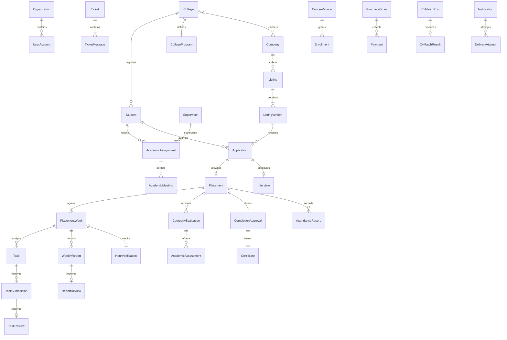

# Installed Bridgeway database (85 tables)

This directory documents the installed SQL Server 2025 database (compatibility level 170). The [database reference page](../docs/database/database.html) contains the separate 60-table revision and its SQL download. The Razor Pages application currently stores portal workflow records in the browser.

## Findings before schema generation

The study covered 14 HTML templates, five roles, 43 runtime sidebar sections, the shared models and editors, local persistence, attachments, imports, exports and 108 existing automated checks. `AGENTS.md` and the user's latest instructions are authoritative.

| Area | Evidence | Database implication |
| --- | --- | --- |
| Accounts and organizations | `shared/js/managed-account-editor.js`: schema, validate, importStudents; `shared/js/portal.js`: BridgewayPartners | Separate people/accounts from college/company identity. Stable IDs replace names and hardcoded personas. No frontend passwords are migrated. |
| College requirements | `shared/js/training-hours.js`: requirement, eligibility, configure | Exactly one current program per college, immutable versions, variable schedules and submitted requirement snapshots. |
| Hiring | `shared/js/student-studio.js`: apply, applicationCards; `shared/js/workspace-cycle.js`: admissions, acceptOffer | Application, company hiring decision, and placement activation are separate. Acceptance atomically closes other pending applications, as required by AGENTS.md. |
| Publication | `pages/company-post-role/company-post-role.js`; `shared/js/workspace-cycle.js`: publications | Company-owned listing versions, moderation decisions, questions, skills, prerequisites and schedule rows. College availability is separate from global publication. |
| Training and tasks | `shared/js/weekly-tasks.js`: deliver, review; `shared/js/training-hours.js`: transition | Placement-specific weeks, immutable report submissions, task/submission versions, company reviews, and one hour verification per week. |
| Completion | `shared/js/internship-journey.js`: sendAcademic, approve, checklist | Separate company evaluation, academic assessment, college confirmation and immutable certificate snapshot for each placement. |
| Attendance | `shared/js/attendance-model.js`: issue, redeem, correct, concern | Two-minute individual/shared QR sessions, atomic redemption, one daily placement record, correction history and requests. Attendance has no hour-credit relationship. |
| Meetings | `shared/js/supervisor-meetings-model.js`; `shared/js/application-interviews.js` | Academic meetings and application interviews retain distinct owners, revisions and events. The student hub is a combined read model. |
| Support | `shared/js/workspace-cycle.js`: ticketRecipient, ticketCanManage, tickets | Routed conversations, immutable messages, handler-only resolution after a reply, and no reopening. |
| Planned features | User clarification; `pages/student-dashboard/student-dashboard.js` course catalogue | Prepare courses/bundles, one-time orders, provider-referenced payments, enrollments, versioned AI role-fit matching and notification attempts. These integrations remain future work. |

### Known frontend discrepancies

* Tasks still reject week indexes above seven (`weekly-tasks.js:weekFor`), while schedules allow up to 52 weeks. Database weeks use the actual agreement length.
* The active company acceptance handler leaves other applications pending until student offer selection. The database follows the authoritative company-acceptance closure rule.
* Assignments and visibility sometimes use supervisor names. Several role scopes use fixed college/company IDs. These are not authentication or safe relationship keys.
* Current plans, evaluations, assessments and certificates are partly keyed by student, with incomplete archival handling for repeat placements. Database history belongs to the original placement.
* Some interview edits replace their prior contents. Database revisions preserve previous schedules and responses.
* A selected CV currently stores only filename/size. No document contents, AI results, users from old password fixtures, or browser records are imported automatically.
* Older documents describe retired attendance and ticket review flows. Those do not override the current rules.

## Conceptual relationship map



## Decisions and assumptions

* One-time course and bundle purchases are confirmed by the user. No subscriptions are assumed.
* Multiple administrator accounts per organization are supported unless the user selects the one-administrator option. Every account has one role and one organization, except Platform Admin. Backend authentication remains separate.
* Monetary values use decimal amounts plus an ISO currency code. Course/bundle content and prices are snapshotted on checkout. No tax or subscription policy is invented. Refund amounts are tracked; entitlement revocation is explicit rather than silently inferred from partial refunds.
* An application does not need an existing partnership row: approved listings are available to all active colleges. An explicitly paused connection blocks new applications and placement activation.
* Academic assignment history is retained independently of placement. Reassignment closes the previous assignment; prior meeting links are visible only to their original participants and become read-only.
* File rows distinguish metadata-only local selections from available server/object-storage files. Storage keys are nullable until a future upload service supplies them. Payment rows contain provider references only, never card data.

## Delivered structure

The model contains **85 tables, 593 columns, 152 foreign-key relationships, 97 CHECK constraints, and 115 explicitly declared secondary/filtered indexes**, in addition to indexes supplied by primary and unique keys. Composite foreign keys count as one relationship. There are ten domain schemas plus `api` and `reporting`, with 54 public API procedures and 60 database guards/triggers. Required child cardinalities, such as a college program, agreed placement weeks and an opening ticket message, are maintained by the creation transactions; a foreign key alone does not establish that a parent has a child.

* `schema.sql`: generated table DDL, named defaults, keys, checks, restrictive foreign keys and indexes.
* `procedures.sql`: transactional account, partnership, recruitment, placement, training, attendance, meeting, support and planned-service procedures; guarded write permissions; append-only and report-lock triggers.
* `validation.sql`: synthetic positive and negative checks. Its database-name guard rejects the actual `Bridgeway` database.
* `installed-model.cjs`: the versioned metadata used to regenerate and verify the installed 85-table schema.
* `../docs/database/database.html`: reference for the revised website schema, including its own SQL download. This document and the installation scripts in this directory describe the installed 85-table version.

Identifiers are `uniqueidentifier` for durable entities. Server defaults use `NEWSEQUENTIALID()`; creation procedures may supply `NEWID()` so an entity ID is available before inserting dependent rows. Natural composite keys identify ordered schedule rows, versions, evaluation criteria, and membership rows. Only the conversation's global ordering number uses `bigint IDENTITY`; it prevents ambiguous ordering of replies with equal millisecond timestamps. Timestamps use UTC `datetime2(3)`, with Amman calendar dates derived through SQL Server's `Jordan Standard Time`. `rowversion` values are concurrency tokens, not dates.

A dedicated append-only audit trail retains actor, role, action and descriptive entity context for identity/access and preference-like changes; workflow-specific histories retain the detailed business transitions. Audit context IDs are not claimed to be polymorphic foreign keys.

All deletes and foreign-key updates use `NO ACTION`. Listings, accounts, assignments and placements use explicit lifecycle changes. History rows are append-only, and no application procedure rewrites prior agreements. A new placement does not reuse the previous placement's plans, evaluations or certificate. Temporary nullable current-version pointers allow parent/version rows to be created in one transaction; the write procedures set the current version before committing.

## Workflow enforcement matrix

| Guarantee | Enforcement | Responsibility outside the database |
| --- | --- | --- |
| Organization/college identity | Subtype keys and composite role/organization foreign keys; scoped account creation | Authentication provider, account recovery, external subject binding |
| Exactly one current program | College program primary key; version FK; organization creation initializes it transactionally | UI maps unlimited weekly hours to NULL |
| Approved listings and eligibility | SubmitListingVersion, ModerateListing and Apply check status, expiry, scope, answers, hours, weeks and weekly limit | Display specific validation errors; upload/CV integration |
| Acceptance closes competing pending applications | Student-row locks, one accepted-offer index and DecideApplication transaction | Authenticate the company administrator; never treat academic assignment as hiring approval |
| Single active placement | Filtered unique student index and ActivatePlacement transaction | Offer-confirmation UI; no extra college hiring stage |
| Agreed week allocations stay fixed | Agreement triggers and immutable application schedule rows | No extension workflow is invented |
| Task versions and report locks | Scoped procedures, latest-submission review, immutable versions, locked-week triggers | PDF header/content validation and malware scanning by a future file service |
| Exactly-once full hour credit | Report review transaction; unique week verification key; allocation guard | Attendance must never call report-credit operations |
| Completion and certificate | Latest evaluation/assessment checks, all weeks/tasks/hours, explicit confirmation; certificate snapshot | Certificate PDF rendering and any public verification service |
| QR expiry and replay | Server time after lock acquisition; SHA-256 token hash; 120-second lifetime; daily/redemption unique keys | HTTPS, authenticated actors, QR rendering, secure ephemeral delivery of raw tokens |
| Corrections | Host-company scope, date/reason validation, append-only events, resolved concern references | No missing day is inferred to be absent |
| Academic and company meetings | Separate records and revision history; participant/assignment checks; overlap checks; supplied-link validation | Zoom/Jitsi room creation, invitations and external calendar availability are not implemented |
| Ticket routing and closure | Receiving-role checks, assignment handoff, reply-driven state, separate confirmed resolution, closed-row triggers | API must derive ActorId from the authenticated session |
| One-time checkout | Quoted product/course snapshots, amount/currency checks, idempotent provider references, deduplicated entitlements | Verify provider signature and payment outcome before ConfirmPayment; currency/tax and refund policy remain service decisions |
| AI role-fit history | Exact CV/listing/model versions; available-file requirement; bounded result and closed-run checks | Execute a real model, document calibration/consent, and never claim hiring probability |
| Notification attempts | Separate queued/attempted/delivered/failed rows, per-recipient idempotency, closed delivery checks | Actual provider dispatch and callback verification; preferences remain consent inputs, not delivery proof |

## Security and transaction boundary

`bridgeway_app_executor` can execute scoped API procedures but cannot directly read or write base domain tables. `bridgeway_worker` has only the service-finalization operations `ConfirmPayment`, `CompleteCvMatch`, `MarkFileAvailable`, and `RecordDeliveryAttempt`. Neither role receives login credentials, database-owner rights, or unrestricted reporting access. No logins or application users are created in the actual database.

**ActorId is a trusted-backend parameter, not proof of identity.** Do not expose SQL credentials or these procedures directly to browsers. A backend must authenticate the caller, derive the actor ID itself, reject client actor overrides, and keep application and worker connections separate. SQL role/tenant checks supplement that boundary. SSMS sysadmins remain privileged maintenance operators; database constraints are not protection against a malicious database owner disabling guards.

Mutations use `XACT_ABORT`, `TRY/CATCH`, rollback, and row/key-range locks where workflows need serialization. The procedures own their transaction; errors roll back the active transaction rather than preserving an arbitrary caller savepoint. Invoke a mutation as its own request. Deadlock/transient retry policy belongs to the backend and must retain request idempotency. Current rowversion columns are available for future optimistic edit checks; they do not by themselves reject stale client drafts.

Filtered indexes require normal ANSI settings and `QUOTED_IDENTIFIER ON`. Use `sqlcmd -I` or the equivalent connection settings. The schema script sets the necessary options explicitly.

## Install or reproduce

The actual application database is `Bridgeway` on the local default instance, accessed using Windows Authentication. The user authorized its creation and schema installation. It contains no validation fixtures. Do not rerun table creation on a populated database: the schema script intentionally stops if user tables already exist. Future upgrades require explicit migrations rather than dropping tables.

For a **new, empty** database selected in SSMS, execute `schema.sql` followed by `procedures.sql`. From the repository root:

```powershell
node tools/build-database.cjs
node tools/check-database.cjs
sqlcmd -S localhost -d Bridgeway -E -C -I -b -i database/schema.sql
sqlcmd -S localhost -d Bridgeway -E -C -I -b -i database/procedures.sql
node tools/inspect-database.cjs Bridgeway
```

`-C` is used here for this local development instance's certificate; configure proper certificate validation for a future remote deployment. Database creation is separate; no file paths, passwords, external subjects or provider secrets are hardcoded. `GO` is an SSMS/sqlcmd batch separator rather than server-side T-SQL.

To validate independently, create a **new disposable** database whose name begins `Bridgeway_Validation_`, install both scripts there, then run:

```powershell
sqlcmd -S localhost -d Bridgeway_Validation_MyRun -E -C -I -b -i database/validation.sql
node tools/check-database-concurrency.cjs Bridgeway_Validation_MyRun
node tools/inspect-database.cjs Bridgeway_Validation_MyRun
```

Never run `validation.sql` in the application database. Validation fixtures include clearly synthetic `.invalid` accounts, fake provider references and test-only AI outputs. They exist only in the disposable database; no messages, payments, meetings or uploads are actually sent. Validation requires an initially empty database and should not be rerun over its previous fixtures.

Open the revised website at `http://127.0.0.1:8080/Reference/Database` with the Bridgeway launch profile. The static reference is at `docs/database/database.html`. Run `node tools/check-database.cjs --website` to check the revised model and its Razor assets.

For the installed version, `node tools/build-database.cjs` regenerates the 85-table schema and its procedural guards from `installed-model.cjs`. Run `node tools/check-database.cjs` to check that version. The read-only `tools/inspect-database.cjs` compares a SQL Server catalog against either model (pass `--website` when inspecting a disposable database created from the revised download).

## Verification performed

* SQL Server 2025 installed the full table schema, constraints, indexes, functions, views, procedures and guards in a separate disposable validation database.
* **40 SQL checks passed**, including an unequal 200-hour schedule over 12 weeks, later-week tasks, frozen agreement allocations, repeated report verification, completion gates, snapshots, cross-college constraints, ticket closure, attendance expiry/replay/corrections, CV content immutability, suspended users and planned payment/AI/notification boundaries.
* Three independent **two-connection races passed**: hiring decisions, weekly verification and shared-code redemption each allowed one successful action and rejected the competing action. Additional reads verified supervisor-wide masking, foreign-company isolation and reassigned-supervisor meeting privacy.
* Metadata validation passed for all 85 tables and 152 relationships, including ordered composite references and exactly one diagram placement per table. The live SQL catalogue matched the metadata.
* Browser checks covered all five tabs, arrow-key navigation, table selection/deselection, workflow/search filters, both link checkboxes with computed SVG visibility, zoom/Fit, table definitions, SQL copy/download, light/dark views, and 390-pixel layout. Downloaded SQL matched `schema.sql` byte for byte. Clipboard comparison normalized Windows CRLF line endings. No field/type collisions or page overflow were observed in these checks.
* Existing application code was not changed during the database implementation. The previously completed 108 frontend checks remain a separate study baseline; database tests do not claim complete frontend/backend integration.

### Visual review

The documentation reuses Bridgeway's navy/blue identity, a quiet tabbed reference layout, and group colors with a concrete diagram meaning. Desktop/mobile screenshots were inspected. Static HTML/CSS/JS review after polish has no actionable findings. The scanner's remaining raw O6 flag is a false positive: `○` is the standard optional-cardinality symbol in the diagram legend, not a decorative dot in a status chip. Before polish the heading also triggered the numeric-word heuristic; the final heading is now a direct subject label. No accent stripes, decorative icon tiles, status-dot chips or cramped action buttons were introduced. The macOS-specific rendered scanner was not used on Windows; Playwright provided the actual browser checks.

## Remaining integration work and explicit assumptions

1. Choose an identity provider and bootstrap the first real Platform Admin through a controlled administrative migration. This schema intentionally contains no fake production accounts, passwords or fabricated identity-provider subjects. For the initial bootstrap only, an authorized database owner inserts the Platform Admin account with a real name/email and no organization, then binds the real external subject when authentication is connected. All subsequent account creation follows administrator-owned procedures.
2. Build the authenticated backend, connection configuration, scoped read endpoints, error translation, pagination, input validation, optimistic draft editing, transient retry handling and frontend adapters. Retain the existing browser workspace until a separately authorized migration. No browser-local data was automatically imported.
3. Implement file uploads and secure object storage. MetadataOnly CV rows cannot be analyzed. Task PDF header validation occurs in the backend; a SQL MIME/type check cannot inspect nonexistent file bytes. Raw attendance secrets are returned once; a backend must deliver individual QR tokens securely to the intended student, using a short-lived protected cache if redisplay is needed. Never log raw tokens or put storage/provider secrets in this database metadata.
4. Integrate payment callbacks, AI execution and notification workers. Refund records support partial/full amounts, but settlement reconciliation, over-refund prevention, tax rules, entitlement-revocation policy and provider-specific webhook contracts require the chosen service implementation. Course authoring and provider administration are future privileged maintenance flows, not new public self-registration or checkout endpoints in this frontend.
5. Multiple administrators per organization are supported as the documented default assumption. The user confirmed one-time individual-course and bundle purchases. There are no subscriptions. Existing non-revoked enrollment is reused when a later paid bundle includes a course already owned; course-version upgrades and refund-driven revocation remain explicit service decisions.
6. No independent mentor account role, subscription engine, fabricated AI percentage, supervisor hiring approval, per-student/week visibility policy or attendance-based credit rule was introduced. Planned future features are structurally ready, while their external services remain unconnected.

SQL implementation references: [Microsoft transaction locking guide](https://learn.microsoft.com/en-us/sql/relational-databases/sql-server-transaction-locking-and-row-versioning-guide?view=sql-server-ver17) and [SQL Server CREATE TRIGGER](https://learn.microsoft.com/en-us/sql/t-sql/statements/create-trigger-transact-sql?view=sql-server-ver17). These explain platform mechanisms; Bridgeway's business authority remains the project rules and user instructions.
